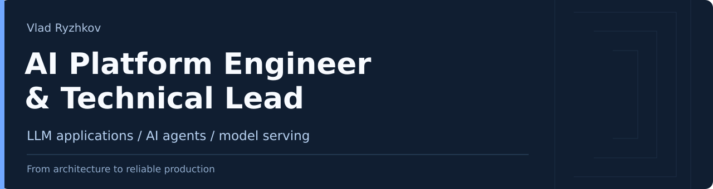

I design and build production AI platforms: LLM applications, agent workflows, persistent memory, and the services that connect them to enterprise data.

My work combines architecture, hands-on production engineering, and technical leadership. It spans multi-tenant AI, reliable model serving, governed data access, and GPU infrastructure.

[LinkedIn](https://www.linkedin.com/in/ryzhkovvlad/) · [Apron](https://github.com/mondegreens/apron)

## Recent engineering work

- **Enterprise AI platforms:** conversational AI, persistent organizational memory, hybrid RAG, governed natural-language analytics, MCP-based tools, and agentic development workflows. Tenant isolation, RBAC, and SSO are part of the platform design.
- **LLM serving and GPU systems:** resource-planning and serving infrastructure for 150+ open-source LLMs, automated vLLM/PyTorch deployments, GPU lifecycle automation, and multi-GPU inference coordination.
- **Production ML platforms:** declarative pipelines, continuous training, and feature stores, including work that reduced model-deployment cycles from months to days.

Role details and delivery history are on [LinkedIn](https://www.linkedin.com/in/ryzhkovvlad/).

## Public work

### [Apron](https://github.com/mondegreens/apron) · Inference planning and verification

Apron connects model compatibility and resource planning with verification records scoped to the artifact, engine, hardware, and workload that produced them.

Explore the [implementation](https://github.com/mondegreens/apron/tree/main/src), [tests](https://github.com/mondegreens/apron/tree/main/tests), [measured records](https://github.com/mondegreens/apron#measured-records), and [architecture decisions](https://github.com/mondegreens/apron/tree/main/docs/adr).

- **[PROOF](https://github.com/data-mission/proof-print-dialog):** a hackathon prototype with a browser interface and a local MCP server for inspecting print jobs. [Try the interface](https://data-mission.github.io/proof-print-dialog/).
- **[Closure](https://github.com/data-mission/closure):** research I originated on verification beyond LLM-as-a-judge through causal interventions and inference dynamics, with structural model control as a longer-term hypothesis. Protocols, results, corrections, and open hypotheses are public. [Current status](https://github.com/data-mission/closure/blob/main/STATUS.md).
- **[Dota2-Cast-Assist](https://github.com/data-mission/dota2-cast-assist):** a Python service for game-state ingestion, Steam-data enrichment, and match-statistics APIs. [System design](https://github.com/data-mission/dota2-cast-assist/blob/main/images/system_design.png).

**Tools I work with:** Python, PostgreSQL / pgvector, Kubernetes, vLLM / PyTorch, GCP / Vertex AI, and AWS.

PhD in Information Technology. Calgary, Canada.
